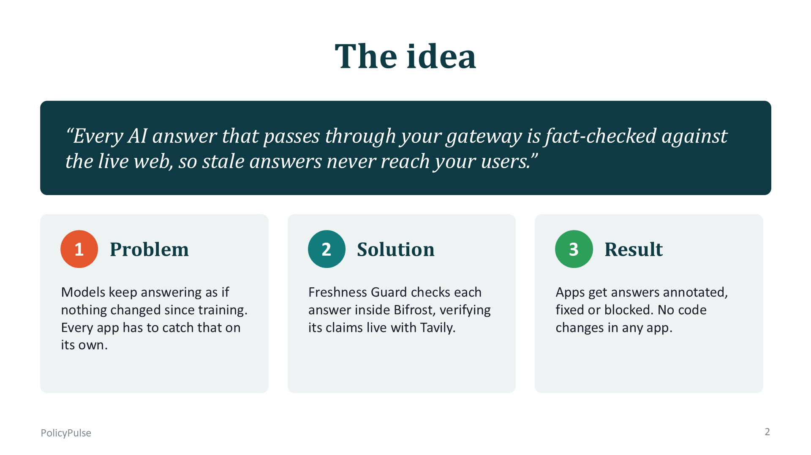
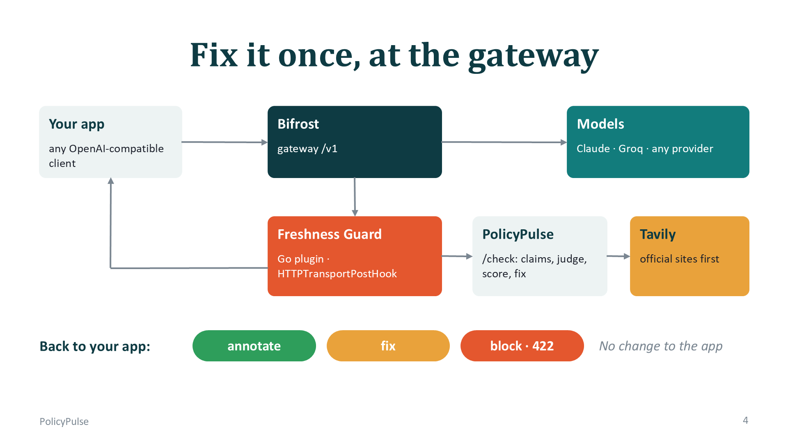
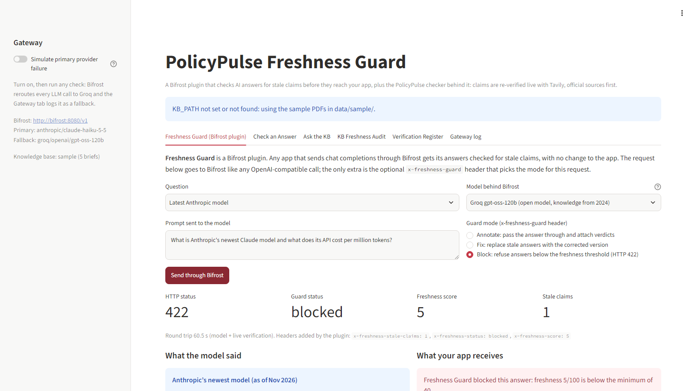
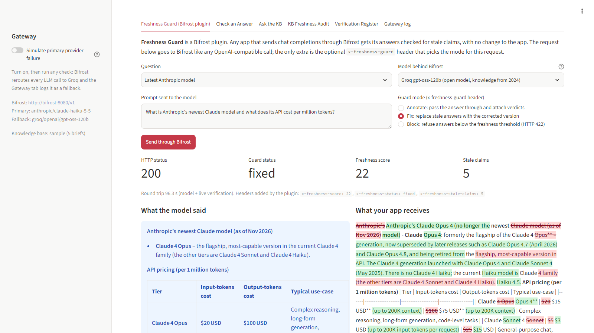
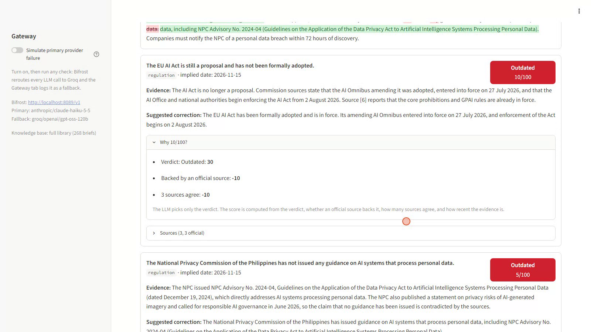
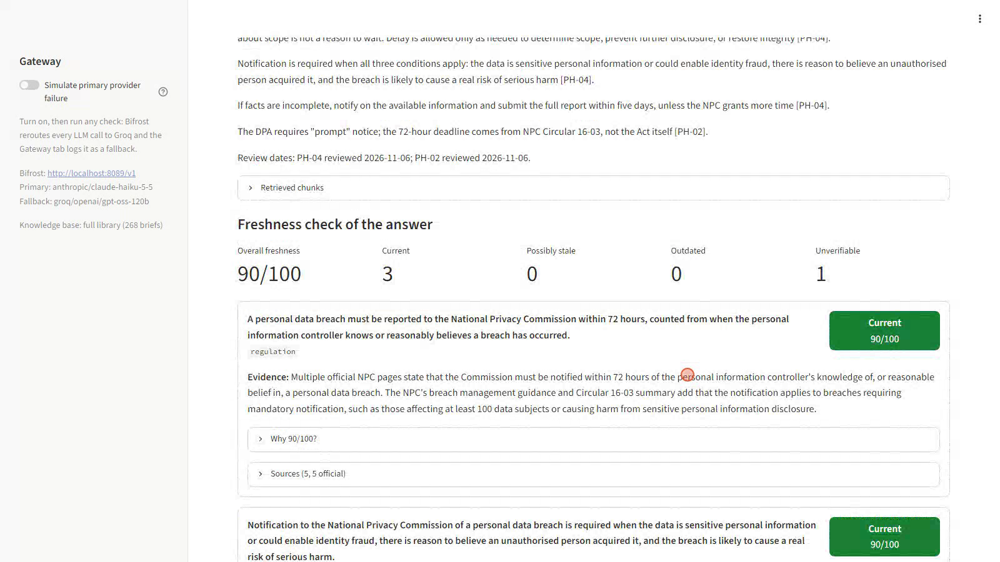
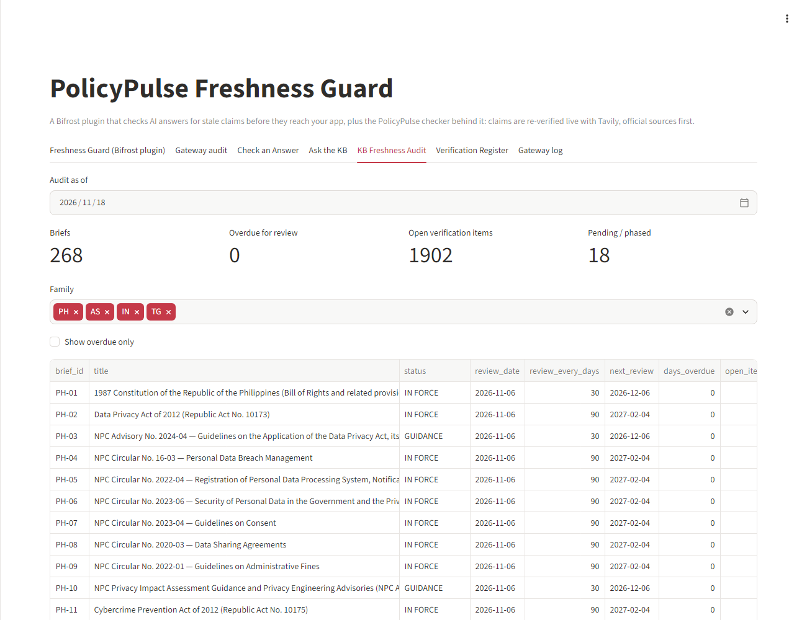
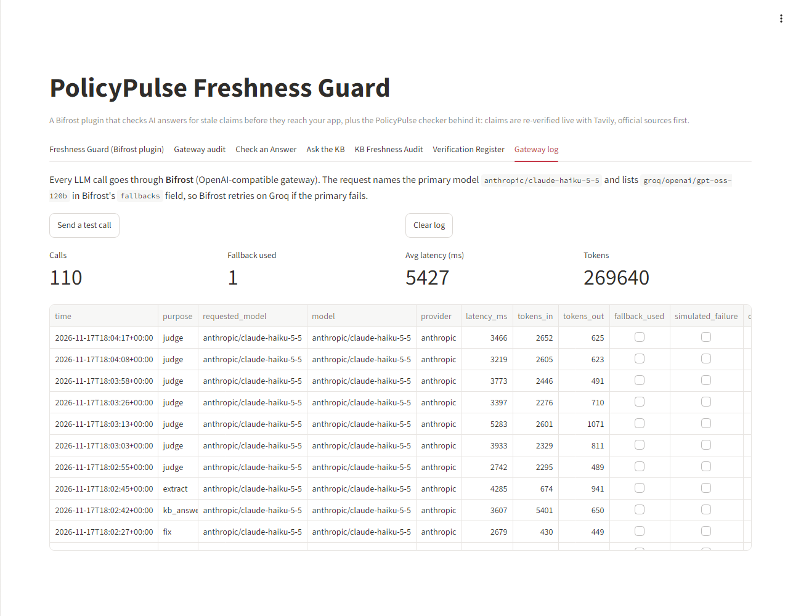

# PolicyPulse Freshness Guard: a Bifrost plugin that stops stale AI answers

> Geek Room Global AI Hackathon 2026 · **Bifrost track: Open-Source Bifrost Gateway** (extend Bifrost with a
> practical feature) · Tavily integration: *Build a Stale-Answer Detector for AI Applications*



LLMs answer with confidence, but laws, regulator circulars, prices, model versions and company facts change
after the training cutoff. Every app built on an LLM inherits that problem, and in AI governance, risk and
compliance a stale answer can mean a missed deadline, a wrong control or a fine.

**Freshness Guard** fixes it at the gateway. It is a native Bifrost plugin: every chat completion that passes
through Bifrost is checked for stale claims before it reaches the calling app. Apps change nothing. They keep
calling Bifrost's OpenAI-compatible API, and each answer comes back **annotated**, **fixed** or **blocked**.

The checking engine is **PolicyPulse**: it extracts time-sensitive claims, re-verifies each one live with
**Tavily** (official regulator and vendor sites first), and gives every claim a verdict and an explainable
0–100 freshness score.



### Real result through the gateway

Asked *"What is Anthropic's newest Claude model and what does its API cost?"*, Groq's `gpt-oss-120b`
(knowledge from 2024) answered "Claude 3.5 Sonnet" with 2024 prices. With `x-freshness-guard: block`, Bifrost
returned **HTTP 422**: *"Freshness Guard blocked this answer: freshness 23/100 is below the minimum of 40"*,
listing each outdated claim with its sources.



In `fix` mode the same request comes back **200 · fixed**, with only the stale parts rewritten:



## Demo videos

- ▶ **Freshness Guard plugin (3:27):** [docs/Freshness_Guard_Demo.mp4](docs/Freshness_Guard_Demo.mp4): starts
  with the idea and the problem it solves, then the one-command Docker build, a stale answer blocked with
  HTTP 422 at the gateway, the same answer fixed, the plugin code, and the PolicyPulse tools behind it. All
  requests are live.
- **PolicyPulse checker app (4:17):** [YouTube](https://youtu.be/ktF9vd21EIM) ·
  [docs/PolicyPulse_Demo.mp4](docs/PolicyPulse_Demo.mp4): every tab of the compliance app.

## Quick start (one command)

Needs Docker. Put your keys in `.env` (copy `.env.example`): `CLAUDE_API`, `GROQ_API`, `TAVILY_API_KEY`.

```bash
git clone https://github.com/sxdkling-ops/policypulse.git
cd policypulse
cp .env.example .env        # add your keys
docker compose up --build   # Bifrost + Freshness Guard on :8080, checker on :8000, app on :8501
```

If port 8080 is taken: `BIFROST_HOST_PORT=8089 docker compose up --build`.

Then call Bifrost like any OpenAI-compatible endpoint:

```bash
curl http://localhost:8080/v1/chat/completions \
  -H "Content-Type: application/json" \
  -H "x-freshness-guard: annotate" \
  -d '{"model": "groq/openai/gpt-oss-120b", "max_tokens": 2000,
       "messages": [{"role": "user", "content": "What is Anthropic'"'"'s newest Claude model?"}]}'
```

Or open http://localhost:8501 and use the **Freshness Guard (Bifrost plugin)** tab.

## What the plugin does

| Mode | What the app receives |
|---|---|
| `annotate` (default) | The original answer, plus a `freshness` object (overall score, per-claim verdicts, sources, suggested corrections) and `x-freshness-*` headers |
| `fix` | The answer rewritten with the corrections applied (only wrong parts change). The original is kept in `freshness.original_answer` |
| `block` | HTTP **422** `stale_answer` when the score is below `min_score`; the stale answer is kept in the error's `freshness` object for audit |
| `off` | Untouched |

The configured mode is the default. Any request can pick its own with the `x-freshness-guard` header
(`off`, `annotate`, `fix`, `block`). Response headers: `x-freshness-status`
(`checked`, `fixed`, `blocked`, `unchecked`, `skipped-…`), `x-freshness-score`, `x-freshness-stale-claims`.

Example `freshness` object (annotate mode, abbreviated):

```json
"freshness": {
  "status": "checked", "mode": "annotate", "overall_score": 57, "has_stale_claims": true,
  "claims": [
    {"claim": "Under the proposed EU AI Act, obligations would phase in over roughly two years...",
     "verdict": "Outdated", "freshness_score": 5, "official_sources": 1,
     "sources": ["https://eur-lex.europa.eu/..."],
     "suggested_correction": "The AI Act entered into force on 1 August 2024 ..."}
  ],
  "checker": "policypulse", "checked_at": "2026-11-17T15:11:20"
}
```

**Design choices**

- **No changes to apps.** It runs in Bifrost's `HTTPTransportPostHook` and works on the standard
  OpenAI-format JSON, so any client, SDK or language is covered.
- **Fail-open by default.** If the checker is down or slow, the answer passes through with
  `x-freshness-status: unchecked`. Set `"fail_open": false` to return 503 instead.
- **No loops.** The checker's own LLM calls go through the same Bifrost with `x-freshness-guard: off`.
- **Skips what it should.** Streaming responses, errors, non-chat routes and very short answers pass through
  untouched (and are marked `skipped-…` where relevant).

## Plugin configuration

In Bifrost's `config.json` (see [`docker/bifrost-config.json`](docker/bifrost-config.json)):

```json
"plugins": [{
  "enabled": true,
  "name": "freshness-guard",
  "path": "/app/plugins/freshness_guard.so",
  "config": {
    "checker_url": "http://policypulse-api:8000/check",
    "mode": "annotate",
    "min_score": 40,
    "timeout_ms": 120000,
    "fail_open": true,
    "min_chars": 40
  }
}]
```

| Key | Default | Meaning |
|---|---|---|
| `checker_url` | `http://localhost:8000/check` | PolicyPulse `/check` endpoint |
| `mode` | `annotate` | `annotate`, `fix`, `block` or `off` |
| `min_score` | `40` | `block` mode: block stale answers scoring below this |
| `timeout_ms` | `90000` | How long to wait for the checker |
| `fail_open` | `true` | Checker unavailable: pass through (`true`) or HTTP 503 (`false`) |
| `min_chars` | `40` | Skip answers shorter than this |

## Building the plugin

Source: [`bifrost-plugin/freshnessguard/`](bifrost-plugin/freshnessguard/) (`main.go` hooks, `guard.go` logic,
`guard_test.go` tests).

Go plugins load only into a **dynamically linked** Bifrost built with the **same Go version and dependency
versions** (see Bifrost's *Building a Dynamically Linked Bifrost Binary* guide). On Linux and macOS only.
[`docker/bifrost.Dockerfile`](docker/bifrost.Dockerfile) does this reproducibly:

1. Clones Bifrost at `transports/v2.5.1` (core `v1.15.2`, Go 1.27.3).
2. Builds `bifrost-http` without `-static`, as the dynamic-build guide describes.
3. Copies the plugin into Bifrost's `transports` module and runs `go vet`, `go test` and
   `go build -buildmode=plugin` there, so the plugin shares Bifrost's exact dependency graph.
4. Ships both in `debian:bookworm-slim`. On startup Bifrost logs `plugin status: freshness-guard - active`.

Run the tests on their own:

```bash
cd bifrost-plugin/freshnessguard
go test -v ./...        # Linux/macOS; on Windows use: docker run --rm -v "%cd%:/src" -w /src golang:1.27.3-bookworm go test ./...
```

The 11 tests cover all four modes, the per-request header, streaming/error/non-chat/short-answer skips,
fail-open and fail-closed, array content parts, config validation, and the exported hook driven with
Bifrost's own `schemas.HTTPRequest` / `schemas.HTTPResponse` types.

## The checker: PolicyPulse

The plugin delegates verification to PolicyPulse (`api.py`, `POST /check`), which:

1. **Extracts** time-sensitive claims (regulation, pricing, API versions, company facts) with an LLM.
2. **Searches** each claim with **Tavily**: first on the official site for that claim (`include_domains`:
   privacy.gov.ph, bsp.gov.ph, eur-lex.europa.eu, anthropic.com…), then the open web. Results are cached.
3. **Judges** each claim against those sources only. The LLM picks the verdict (Current / Possibly stale /
   Outdated / Unverifiable) and must say Unverifiable rather than guess.
4. **Scores** each claim with a transparent formula: verdict base (Current 70 · Possibly stale 50 · Outdated 30),
   ±10 for official backing, ±5 per agreeing source (max ±10), ±10 for evidence from the last 12 months.
5. **Fixes** the answer, changing only the wrong parts.

PolicyPulse also ships a Streamlit app (http://localhost:8501) for compliance teams:

| Tab | What it does |
|---|---|
| **Freshness Guard (Bifrost plugin)** | Sends a question through Bifrost with the plugin on; shows what the model said next to what the app receives, the plugin's headers and the checked claims |
| **Check an Answer** | Paste any answer → verdict cards, *Why N/100?* breakdown, official sources, corrected answer with a diff, Markdown report |
| **Ask the KB** | BM25 search over a library of 268 AI GRC briefs → grounded answer citing brief IDs → freshness check of that answer |
| **KB Freshness Audit** | Every brief with status, review cycle and overdue flag |
| **Verification Register** | Verify the library's own 1,902 open fact-check items live, export CSV |
| **Gateway log** | Every LLM call with model, provider, latency, tokens and fallback; a switch simulates a primary-provider outage to show Bifrost's fallback to Groq |

## How Bifrost is used

- **Plugin (the entry):** Freshness Guard is a native Go plugin using Bifrost's `HTTPTransportPostHook`
  extension point, loaded from `config.json` into a standard dynamic build.
- **Gateway for every LLM call:** PolicyPulse calls models only through Bifrost's OpenAI-compatible endpoint,
  with provider keys held by Bifrost (`env.CLAUDE_API`, `env.GROQ_API`), never by the app.
- **Fallbacks:** each request names `anthropic/claude-haiku-5-5` and lists `groq/openai/gpt-oss-120b` in
  Bifrost's native `fallbacks` field. The app reads `routing_info.is_fallback` and logs it per call.

## How Tavily is used

- Every claim gets a basic-depth search limited to the official sites for that claim, then an open-web search.
  Official sources are labelled and weigh into the score.
- The Verification Register turns the knowledge base's own "verify this" notes into live searches.
- Results are cached by query (`cache/tavily_cache.json`), and a check is capped at 8 claims.

## How AI is used

- **Claim extraction**, **judging** (sources only, temperature 0) and **correcting** (only wrong parts change)
  are LLM steps, all routed through Bifrost. The freshness score is computed, not generated.
- **Built with Claude Code:** this project was designed and coded with Claude Code.

## Repository layout

```text
bifrost-plugin/freshnessguard/   Go plugin: main.go (hooks), guard.go (logic), guard_test.go
docker/                          bifrost.Dockerfile (dynamic Bifrost + plugin), bifrost-config.json,
                                 policypulse.Dockerfile
docker-compose.yml               Bifrost + checker + app
api.py                           POST /check (the checker the plugin calls)
pipeline.py extractor.py verifier.py judge.py authority.py fixer.py llm.py   PolicyPulse engine
app.py guard_demo.py             Streamlit app
ingest.py retriever.py           knowledge base (PDF ingest, BM25)
bifrost/config.json run_bifrost.py   run a stock Bifrost via npx for the app alone (no plugin)
```

## Running without Docker (app only, no plugin)

```bash
pip install -r requirements.txt
python run_bifrost.py 8080      # stock Bifrost via npx with Claude + Groq (keys from .env)
python ingest.py                # KB index (uses data/sample/ if KB_PATH is not set)
streamlit run app.py            # app; the Freshness Guard tab needs the Docker gateway
uvicorn api:app --port 8000     # the /check API
python smoke_test.py            # "The EU AI Act is still a proposal" → expects Outdated
```

## Limitations

- A check adds latency (typically 30–80 s: claim extraction, live search and judging). That suits compliance
  assistants and reviewed answers more than real-time chat; see *Future work* for an async mode.
- Streaming responses are not checked yet (passed through, marked `skipped-stream`).
- Go plugins need a dynamic Bifrost build on Linux or macOS; the Dockerfile handles this.
- Verdicts depend on what Tavily finds. The judge is an LLM and can misread a source, so sources are always
  returned for review.
- The knowledge base in this repo is a five-brief sample; the full 268-brief library is private.

## Future work

- **Async mode:** return the answer immediately and attach verdicts through Bifrost's logs and a webhook.
- **Streaming support** using `HTTPTransportStreamChunkHook` to buffer and check the final text.
- Per-virtual-key modes through Bifrost governance (for example `block` for customer-facing keys).
- Metrics (stale answers caught, by provider and model) through Bifrost telemetry.
- Mapping verdicts to ISO/IEC 42001 controls and NIST AI RMF functions for audit evidence.

## Screenshots

**Check an Answer:** overall score, corrected answer (red removed, green added), verdict cards


**Why 10/100?** The score breakdown and the official sources behind a verdict


**Ask the KB:** a grounded answer from the knowledge base, then a live freshness check of that answer


**KB Freshness Audit:** 268 briefs, review cycles and 1,902 open verification items


**Verification Register:** open fact-check items from a BSP brief, verified live


**Gateway log:** every LLM call with model, provider, latency, tokens and fallback


**`/check` API**, the endpoint the plugin calls


---
Not legal advice. Verify against official sources.
