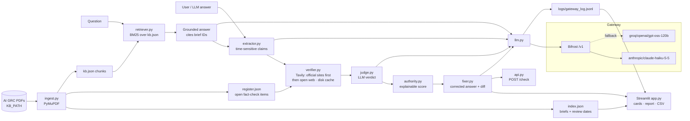

# PolicyPulse — Stale-Answer Detector for AI Governance & Compliance

> Geek Room Global AI Hackathon · Problem: *Build a Stale-Answer Detector for AI Applications*

LLMs answer compliance questions with confidence, but laws, regulator circulars, prices, model versions and
company facts change after the training cutoff. In AI governance, risk and compliance (GRC) a stale answer is
not just wrong: it can lead to a missed deadline, a wrong control, or a fine.

**PolicyPulse** takes any LLM answer, pulls out the claims that can go out of date, re-checks each one against
live web sources with **Tavily** (official regulator and vendor sites first), and gives every claim a verdict and
an explainable freshness score. It then rewrites the answer with the corrections, showing exactly what changed.
All LLM calls go through the **Bifrost** gateway with automatic fallback from Claude to Groq. Other AI apps can
call it through a one-endpoint API before they show an answer to a user.

### What makes it different

- **Official sources first.** Each claim is searched on the regulator's or vendor's own site (privacy.gov.ph,
  bsp.gov.ph, eur-lex.europa.eu, openai.com…) before the open web, and official sources are labelled.
- **A score you can explain.** The LLM only picks the verdict. The 0–100 score is computed from the verdict,
  official backing, how many sources agree and how recent the evidence is, and each card shows the breakdown.
- **It fixes the answer.** A corrected version of the answer is shown with removed text in red and added text
  in green.
- **It audits its own knowledge base.** The KB's 1,902 open "verify this" notes can be checked live too.

## Quick start

```bash
pip install -r requirements.txt
python run_bifrost.py 8080      # terminal 1: Bifrost with Claude + Groq (keys from .env)
python ingest.py                # builds the KB index (uses data/sample/ if KB_PATH is not set)
streamlit run app.py            # terminal 2: the app
uvicorn api:app --port 8000     # optional: the /check API
```

Full setup is under [Install and run](#install-and-run).

## Features

| Tab | What it does |
|---|---|
| **Check an Answer** | Paste any LLM answer → time-sensitive claims → live Tavily evidence (official sources first) → colour-coded verdict cards (Current / Possibly stale / Outdated / Unverifiable), explainable 0–100 freshness score, stale-risk flag for claims that assume an old date, suggested correction, labelled sources, overall score, and the **corrected answer** with changes highlighted. Four sample answers (AI regulation, LLM API pricing, Philippine AI and privacy rules, company CEO). Markdown report download. |
| **Ask the KB** | Ask the AI GRC knowledge base → BM25 retrieval → grounded answer citing brief IDs (e.g. `[PH-04]`) and their review dates → the stale check runs automatically on that answer. Markdown report download. |
| **KB Freshness Audit** | Every brief in the KB with status, last review date, review cycle, next review date and open verification items. Overdue briefs are highlighted; move "Audit as of" forward to see what falls due. |
| **Verification Register** | Pick open fact-check items from the KB's Verification Register (1,902 items across 268 briefs) → Tavily searches the brief's own official source first, then the open web → verdict, score, sources → export CSV. |
| **Gateway (Bifrost)** | Log of every LLM call: model, provider, latency, tokens, fallback used. Sidebar toggle **Simulate primary provider failure** forces the Groq fallback path. |
| **API** (`api.py`) | `POST /check` with `{"answer": "...", "fix": true}` returns the overall score, `has_stale_claims`, the corrected answer and every claim's verdict, score breakdown and sources. `GET /health` reports gateway and key status. Interactive docs at `/docs`. |

## Architecture



## How Tavily is used

- `verifier.py` first runs a **basic-depth** search limited with `include_domains` to the official sites for
  that claim (the regulator, standards body or vendor, picked from the claim's entities and the KB's own
  official-source links), then an open-web search. Results are merged, de-duplicated and labelled *official*.
  Each search is 1 credit with `max_results=5`.
- The Verification Register tab turns each open fact-check item into a search, so the KB's own "verify this"
  notes are checked against the live web.
- Free-tier friendly: every result is cached in `cache/tavily_cache.json` keyed by query, so repeat runs cost
  0 credits, and a check is capped at **8 claims**.

## How the freshness score works

The LLM judge picks only the **verdict**, using the sources alone. The score is then computed in
`authority.py`, so it can be explained and reproduced:

| Part | Points |
|---|---|
| Verdict base | Current 70 · Possibly stale 50 · Outdated 30 · Unverifiable 50 (no adjustments) |
| Backed by an official source | ±10 |
| Extra sources that agree | ±5 each, up to ±10 |
| Evidence from the last 12 months | ±10 |

Evidence moves the score away from the middle in the verdict's direction (up for Current, down for stale), and
the result is kept within 0–100. Example: *"The EU AI Act is still a proposal"* → Outdated 30, two agreeing
sources −5, recent evidence −10 = **15**. Every card has a *Why 15/100?* panel with this breakdown.

## How Bifrost is used

- `llm.py` is the only place that calls an LLM. It uses the `openai` SDK with `base_url = BIFROST_URL`, so
  provider keys live in Bifrost, not in the app.
- Each request names the primary model `anthropic/claude-haiku-5-5` and passes Bifrost's native
  `"fallbacks": ["groq/openai/gpt-oss-120b"]` in the request body. If Anthropic fails, Bifrost retries on Groq.
- Every call is logged to `logs/gateway_log.jsonl` with the model that answered, provider, latency, tokens and
  whether the fallback was used (from Bifrost's `routing_info.is_fallback`). The Gateway tab shows the log.
- The **Simulate primary provider failure** toggle sends the request to a model that does not exist on the
  primary provider, so you can watch Bifrost switch to Groq live.

## Tech stack

Python 3.11+, Streamlit, FastAPI, tavily-python, openai SDK (pointed at Bifrost), Bifrost gateway, PyMuPDF,
rank_bm25, pandas, python-dotenv. No embeddings and no vector DB.

## Install and run

1. **Bifrost** (in its own terminal, leave it running). Put `CLAUDE_API` and `GROQ_API` in `.env`, then:
   ```bash
   python run_bifrost.py          # port 8080; or: python run_bifrost.py 8089
   ```
   This starts `npx -y @maximhq/bifrost` with [`bifrost/config.json`](bifrost/config.json), which declares the
   Anthropic and Groq providers and reads their keys from environment variables (`env.CLAUDE_API`,
   `env.GROQ_API`), so no key is ever written to a file in the repo. Set `BIFROST_URL` to match the port.
2. **App:**
   ```bash
   git clone https://github.com/sxdkling-ops/policypulse.git
   cd policypulse
   cp .env.example .env      # then add TAVILY_API_KEY, BIFROST_URL, KB_PATH
   pip install -r requirements.txt
   python ingest.py          # builds build/index.json, register.json, kb.json
   streamlit run app.py
   ```
3. Optional API: `uvicorn api:app --port 8000`, then open http://localhost:8000/docs or:
   ```bash
   curl -X POST http://localhost:8000/check -H "Content-Type: application/json" -d '{"answer": "Anthropic'"'"'s newest model is Claude 2."}'
   ```
4. Optional check: `python smoke_test.py` runs the full pipeline on
   *"The EU AI Act is still a proposal and has not been adopted."* and expects **Outdated**.

`.env`:

| Variable | Meaning |
|---|---|
| `TAVILY_API_KEY` | Tavily key (app.tavily.com) |
| `CLAUDE_API`, `GROQ_API` | Provider keys, read by Bifrost only (via `run_bifrost.py`) |
| `BIFROST_URL` | Bifrost OpenAI-compatible endpoint, default `http://localhost:8080/v1` |
| `KB_PATH` | Folder with the KB PDFs. If unset or missing, `data/sample/` is used |
| `KB_FOLDERS` | Optional; `;`-separated subfolders to chunk (default: Topic Guides + Philippines) |

## Usage

1. **Check an Answer:** pick "AI regulation (has a stale claim)" and click *Check freshness*. The EU AI Act
   claim comes back **Outdated** with a correction, labelled sources, a *Why…/100?* breakdown, and a corrected
   answer with the changes highlighted. Try the Philippine sample too: the BSP claim is caught as Outdated from
   the BSP's own site.
2. **Ask the KB:** ask "When must a personal data breach be reported to the NPC?" You get an answer citing
   `[PH-04]` with its review date, then a freshness check of that answer.
3. **KB Freshness Audit:** set "Audit as of" a few months ahead to see which briefs fall due for review.
4. **Verification Register:** choose a brief (e.g. `PH-02`), select open items, verify, export CSV.
5. **Gateway:** turn on *Simulate primary provider failure* in the sidebar, run any check, and watch the log
   show `groq/openai/gpt-oss-120b` with *fallback used*.

## Knowledge base

The full KB is a private collection of ~280 AI GRC reference PDFs: Philippine laws and regulator issuances
(`PH-xx`), Asian (`AS-xx`) and international (`IN-xx`) laws and standards, and practice topic guides (`TG-xx`),
plus a Master Index and a Verification Register. **It is not in this repo.** `data/sample/` holds five sample
briefs (PH-02, PH-03, PH-04, IN-01, TG-08) and the Verification Register so the app runs out of the box.

`ingest.py` reads each brief's header (title, type, status, *Last reviewed*, official source), parses the
Verification Register into one row per open item, and chunks brief text (~800 tokens) for BM25.

## How AI is used

- **Claim extraction:** the LLM rewrites each time-sensitive statement as a standalone claim with category,
  entities and implied date (JSON).
- **Judging:** the LLM compares one claim with the Tavily sources only, preferring official ones when sources
  disagree. It is told never to invent facts and to return *Unverifiable* when the sources do not settle it.
  It picks the verdict and the supporting sources; the score itself is computed, not generated. Temperature 0.
- **Correcting:** the LLM rewrites the answer applying only the judge's corrections and keeps everything else
  word for word; the app shows a word-level diff.
- **Grounded KB answers:** the LLM answers only from retrieved KB excerpts and cites brief IDs.
- **Built with Claude Code:** this project was designed and coded with Claude Code.

## Limitations

- Verdicts depend on what Tavily finds; paywalled or very new regulator texts can come back *Unverifiable*.
- The list of official sites is a starter map (Philippine regulators, EU, standards bodies, major AI vendors)
  plus every official link in the KB; other domains fall back to the open-web search.
- The judge is an LLM: it can misread a source. Always open the sources for anything that matters.
- BM25 is keyword search, so paraphrased questions can miss relevant chunks.
- Review cycles in the audit tab follow the Master Index schedule by brief family, not per-brief rules.
- MVP ingest covers the two index files, the Topic Guides and the Philippine briefs.

## Future work

- Scheduled re-checks of the whole KB and of past answers, using the `/check` API.
- Alerts to policy owners when a claim they rely on turns stale.
- Mapping each verdict to ISO/IEC 42001 controls and NIST AI RMF functions.
- The full 280-brief KB with embeddings and hybrid search.

## Screenshots

See `screenshots/` (Check an Answer, Verification Register, Gateway).

---
Not legal advice. Verify against official sources.
