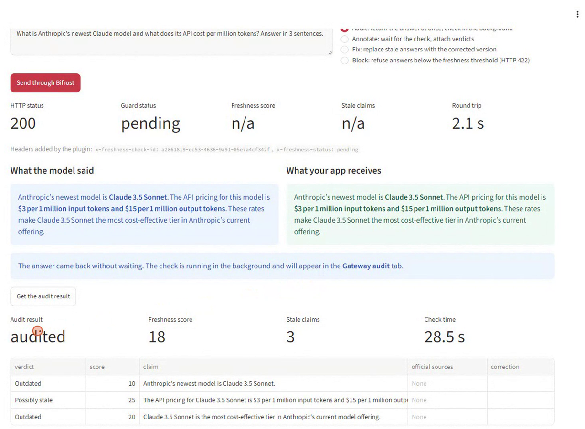
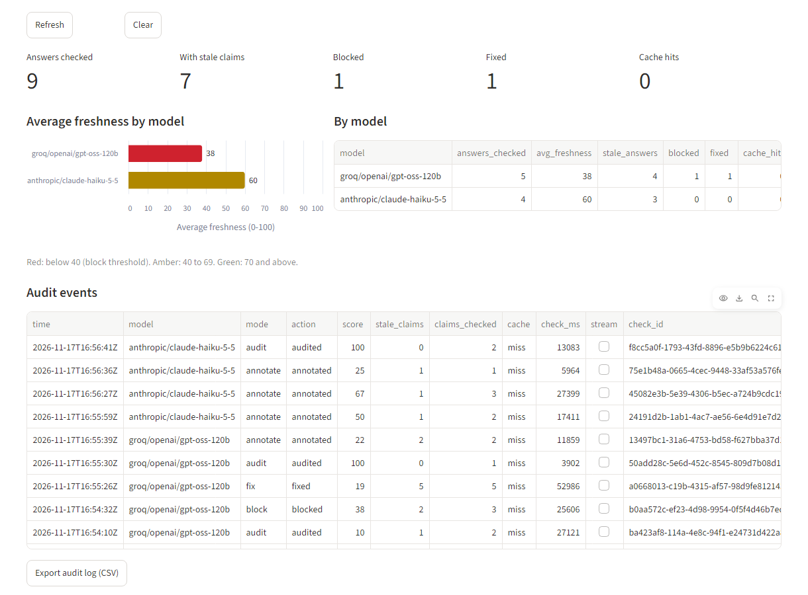
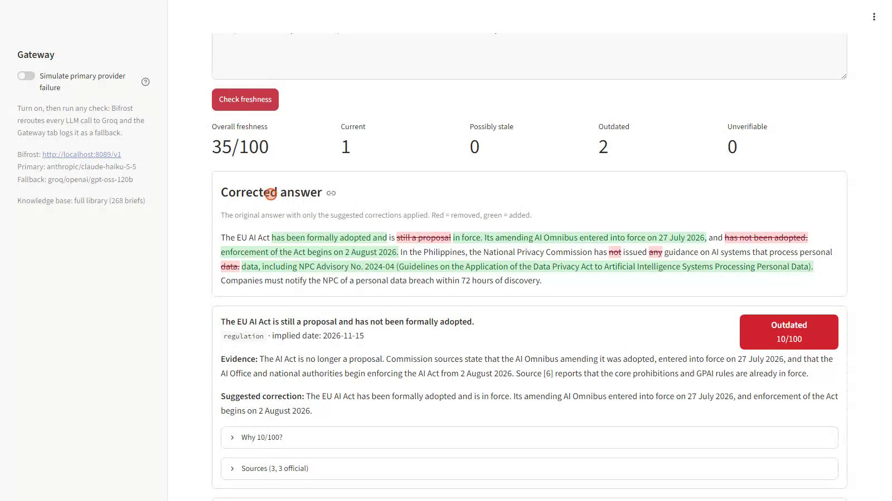
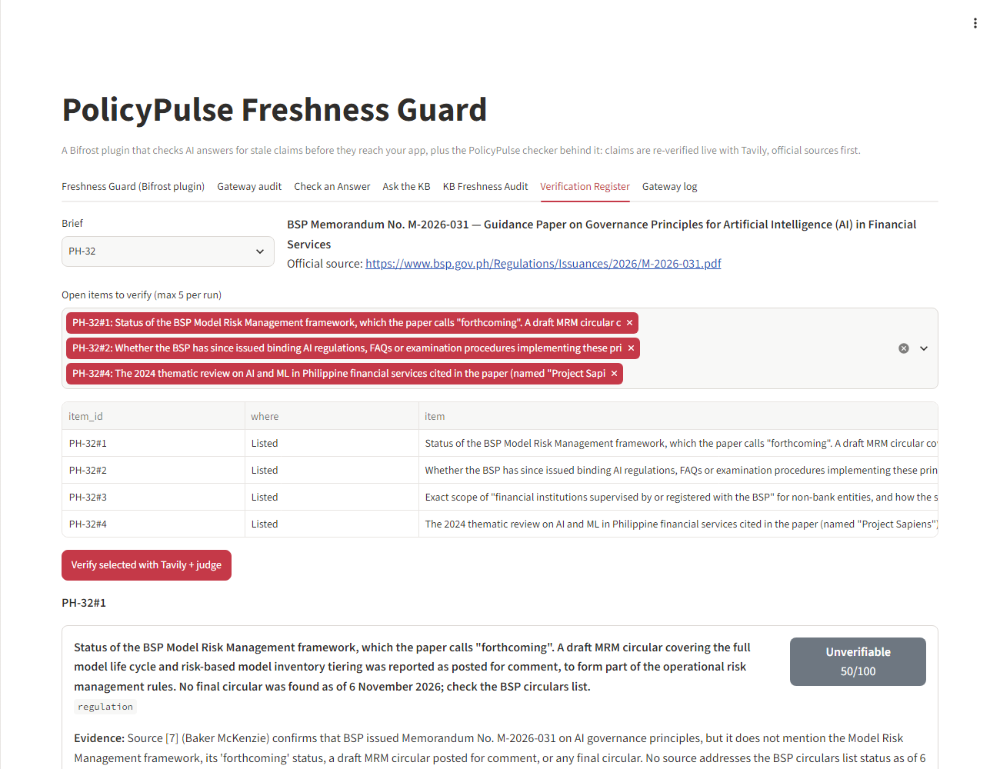
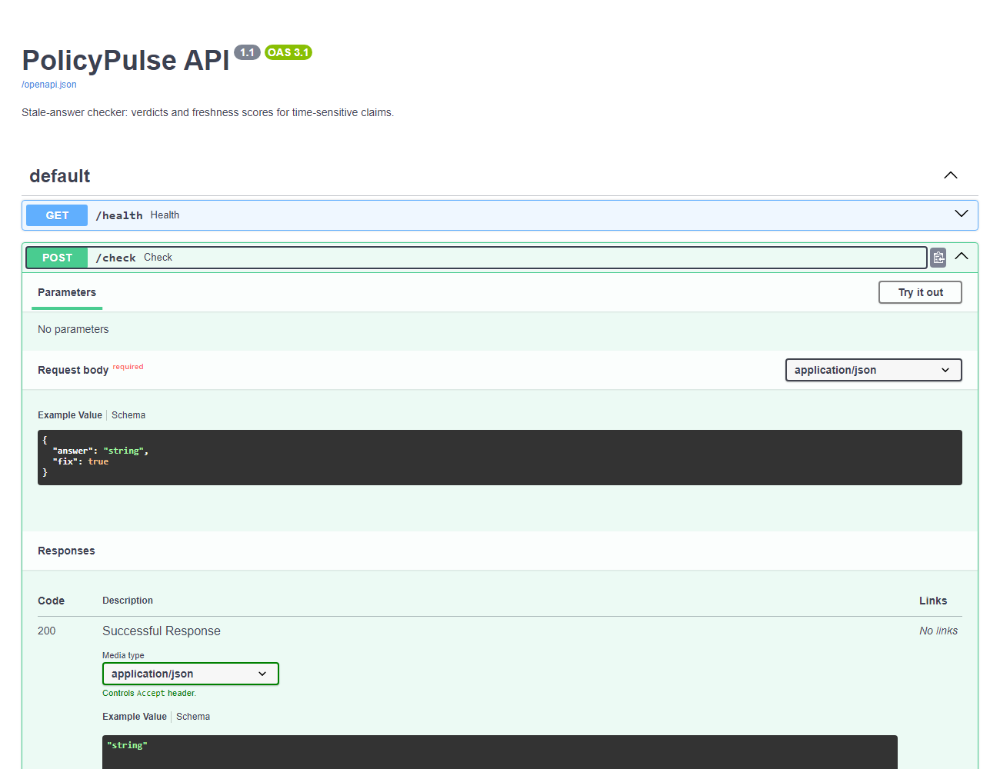

# PolicyPulse Freshness Guard: a Bifrost plugin that stops stale AI answers

[](https://github.com/sxdkling-ops/policypulse/actions/workflows/ci.yml)

> Geek Room Global AI Hackathon 2026 · **Bifrost contributor track: Build a Feature the Open-Source Gateway Is
> Missing** · Tavily integration: *Build a Stale-Answer Detector for AI Applications*


## The operator problem

A gateway operator can see latency, cost and errors for every model call. What the gateway cannot tell them is
whether the answers are **still true**. Models answer from training data that stops at a cutoff, and present
it as current: an old price, a superseded model, a law that has since changed. Every app behind the gateway
inherits the problem, and each team would have to build its own check.

**Freshness Guard** adds that missing capability to Bifrost as a native plugin. Every chat completion that
passes through the gateway can be checked for stale claims, with no change to any app:

| The operator needs | Freshness Guard does |
|---|---|
| No added latency on normal traffic | **Audit mode**: the answer returns at once, the check runs in the background |
| Hard guarantees on sensitive routes | **Fix** (stale parts corrected) or **block** (HTTP 422), chosen per request with one header |
| Predictable cost | **Smart skip** for answers with nothing time-sensitive, **sampling**, **per-model filters**, **verdict cache** |
| Streaming covered | Streamed answers are collected and audited when the stream ends |
| Visibility | Every check goes to an **audit webhook** with the model, score and Bifrost request ID; a dashboard shows freshness by model |
| Safety | Fail-open by default; background checks are bounded and never queue behind requests |

The checking engine is **PolicyPulse**: it extracts time-sensitive claims, verifies each one live with
**Tavily** (official regulator and vendor sites first), and returns a verdict and an explainable 0–100
freshness score per claim.


## Try it with no API keys

```bash
git clone https://github.com/sxdkling-ops/policypulse.git
cd policypulse
docker compose -f docker-compose.demo.yml up --build     # the first build compiles Bifrost: about 10 minutes
```

This starts a **real Bifrost v2.5.1 with the plugin loaded**. Only the model and the live checks are
stand-ins: a mock model replays answers recorded from a real 2024-era model (Groq `gpt-oss-120b`), and the
checker replays the real Tavily-backed checks recorded for those answers (`demo/record_replay.py` made both).

Then either run the end-to-end test (29 checks, standard library only):

```bash
python scripts/e2e_test.py
```

or call the gateway yourself:

```bash
# Block mode: the model says the EU AI Act entered into force in July 2023. Bifrost returns HTTP 422.
curl -i http://localhost:8080/v1/chat/completions -H "Content-Type: application/json" \
  -H "x-freshness-guard: block" \
  -d '{"model": "openai/mock-2024", "messages": [{"role": "user", "content": "When did the EU AI Act enter into force?"}]}'
```

or open http://localhost:8501 (tabs **Freshness Guard** and **Gateway audit**).

If port 8080 is taken: `BIFROST_HOST_PORT=8089 docker compose -f docker-compose.demo.yml up --build`, then
`python scripts/e2e_test.py http://localhost:8089`.

## Run it for real (live models and live Tavily checks)

```bash
cp .env.example .env        # add CLAUDE_API, GROQ_API, TAVILY_API_KEY
docker compose up --build   # Bifrost + Freshness Guard :8080, checker :8000, app :8501
```

```bash
curl -i http://localhost:8080/v1/chat/completions -H "Content-Type: application/json" \
  -d '{"model": "groq/openai/gpt-oss-120b", "max_tokens": 1500,
       "messages": [{"role": "user", "content": "What is Anthropic'"'"'s newest Claude model and what does it cost?"}]}'
```

The configured default is `audit`, so this returns in about a second with `x-freshness-status: pending`. The
verdicts arrive in the audit log (`GET http://localhost:8000/audit`) and the **Gateway audit** tab.

## Results

All four screenshots are live requests through Bifrost to Groq's `gpt-oss-120b` (knowledge from 2024), asked
for Anthropic's newest model and its price. It answered with an old model and old prices.

**Audit mode (the default): no added latency.** The answer came back in 2.1 s, untouched and marked
`pending`. The check finished in the background and scored it 18/100 with 3 stale claims.



**Block mode: stale answers never reach the app.** Bifrost returned HTTP 422 with the score in the headers.


**Fix mode: only the stale parts are rewritten.** The app receives the corrected answer (red removed, green
added); the original is kept in the response for audit.


**What the operator sees.** Live audit results for the same questions sent to two models through one gateway.
The 2024-era model averages 38; the current model 60, because even a current model has stale answers.



| | `audit` mode | `annotate` / `fix` / `block` |
|---|---|---|
| Added latency | **none**: requests returned in 1–2 s, the model's own response time | one live check, typically 15–60 s |
| Repeat of a known answer | annotated at once from the cache | served from the cache |
| Answer with nothing time-sensitive | skipped, no cost | skipped, no cost |

## Modes

| Mode | What the app receives |
|---|---|
| `audit` | The untouched answer, `x-freshness-status: pending` and a check ID. Known answers come back annotated from the cache |
| `annotate` | The answer plus a `freshness` object (score, per-claim verdicts, sources, corrections) |
| `fix` | The answer with stale parts corrected; the original in `freshness.original_answer` |
| `block` | HTTP **422** `stale_answer` when the score is below `min_score` |
| `off` | Untouched |

The default comes from the plugin config. Any request can pick its own with `x-freshness-guard`. Response
headers: `x-freshness-status`, `x-freshness-score`, `x-freshness-stale-claims`, `x-freshness-cache`,
`x-freshness-check-id` (Bifrost's own request ID, so audit events line up with Bifrost's logs).

Full reference (all config keys, the checker contract, the audit event format):
[`bifrost-plugin/freshnessguard/README.md`](bifrost-plugin/freshnessguard/README.md).

## How it meets the Bifrost problem statement

| Requirement | Where |
|---|---|
| **Real operator problem**, solved end to end | Gateways can't tell whether answers are still true. Plugin + checker + audit dashboard, with latency and cost controls so it can stay on in production |
| **Public extension points** | A native Go plugin using `Init`, `GetName`, `Cleanup`, `HTTPTransportPostHook`, `HTTPTransportResponseHeadersHook` and `HTTPTransportStreamChunkHook`, configured through `plugins` in `config.json`. No Bifrost code is modified |
| **Reproducible integration** | One command, no API keys: `docker compose -f docker-compose.demo.yml up --build`. The image builds unmodified Bifrost `transports/v2.5.1` from source |
| **Contribution quality** | 21 unit tests (race detector), 29 end-to-end checks in real Bifrost, CI on every push, plugin README with config, contract and upstream layout, Apache-2.0 |

**About "standard Bifrost installation".** Bifrost loads custom Go plugins only into a dynamically linked
build made with the same Go and dependency versions; the prebuilt `npx` and Docker binaries are static. This
is Bifrost's documented route for custom plugins (*Building a Dynamically Linked Bifrost Binary*), and
[`docker/bifrost.Dockerfile`](docker/bifrost.Dockerfile) automates it: it clones Bifrost at `transports/v2.5.1`,
builds `bifrost-http` without `-static`, compiles the plugin inside Bifrost's own `transports` module so
versions cannot drift, and runs the plugin's tests during the build. The gateway itself is stock source.

## Tests

| Suite | What it proves | Run |
|---|---|---|
| `bifrost-plugin/freshnessguard/guard_test.go` (21 tests, `-race`) | Every mode, header override, cache, smart skip, sampling, model filters, bounded background checks, fail-open/closed, webhook events, config validation, all three hooks with Bifrost's own types, two interleaved streams | `make -C bifrost-plugin/freshnessguard test` |
| `scripts/e2e_test.py` (29 checks) | The plugin loaded in real Bifrost: annotate, cache hit, fix, block, pass-through of current answers, smart skip, off, audit with webhook, streaming audit, per-model stats | `python scripts/e2e_test.py` against the demo stack |
| GitHub Actions | Both of the above on every push, with no secrets | [CI workflow](.github/workflows/ci.yml) |
| `smoke_test.py` | The live checker: "The EU AI Act is still a proposal" must come back Outdated | `python smoke_test.py` (needs keys) |

## The checker: PolicyPulse

The plugin talks to any service that implements its small contract (`POST {answer, fix}`). This repository's
checker (`api.py`) does five things:

1. **Extracts** time-sensitive claims (regulation, pricing, API versions, company facts) with an LLM.
2. **Searches** each claim with **Tavily**: first on the official site for that claim (`include_domains`:
   privacy.gov.ph, bsp.gov.ph, eur-lex.europa.eu, anthropic.com…), then the open web. Results are cached.
3. **Judges** each claim against those sources only. The LLM picks the verdict (Current / Possibly stale /
   Outdated / Unverifiable) and must say Unverifiable rather than guess.
4. **Scores** each claim with a transparent formula: verdict base (Current 70 · Possibly stale 50 · Outdated 30),
   ±10 for official backing, ±5 per agreeing source (max ±10), ±10 for evidence from the last 12 months.
5. **Fixes** the answer, changing only the wrong parts.

It also stores the plugin's audit events (`POST /audit`, `GET /audit`, `GET /audit/stats`).

PolicyPulse ships a Streamlit app (http://localhost:8501):

| Tab | What it does |
|---|---|
| **Freshness Guard (Bifrost plugin)** | Sends a question through Bifrost in any mode; shows what the model said next to what the app receives, the plugin's headers and the checked claims |
| **Gateway audit** | The operator view: answers checked, stale, blocked, fixed, cache hits, average freshness by model, the event log, CSV export |
| **Check an Answer** | Paste any answer → verdict cards, *Why N/100?* breakdown, official sources, corrected answer with a diff |
| **Ask the KB** | BM25 search over a library of 268 AI governance briefs → grounded answer → freshness check of that answer |
| **KB Freshness Audit** · **Verification Register** | Review cycles for the library, and live checks of its 1,902 open fact-check items |
| **Gateway log** | Every checker LLM call with model, provider, latency, tokens and fallback |

## How Bifrost and Tavily are used

**Bifrost**
- **The plugin** (the entry): three HTTP transport hooks plus lifecycle, loaded from `config.json`.
- **Gateway for every LLM call:** the checker calls models only through Bifrost's OpenAI-compatible endpoint;
  provider keys are held by Bifrost (`env.CLAUDE_API`, `env.GROQ_API`), never by the app. The checker's own
  calls carry `x-freshness-guard: off`, so the guard never checks itself.
- **Fallbacks:** requests name `anthropic/claude-haiku-5-5` and list `groq/openai/gpt-oss-120b` in Bifrost's
  native `fallbacks` field; the app logs `routing_info.is_fallback` per call.
- **Custom provider:** the keyless demo registers the mock model as an OpenAI-compatible provider with
  `network_config.base_url`.

**Tavily**
- Every claim gets a basic-depth search limited to the official sites for that claim, then an open-web search.
  Official sources are labelled and weigh into the score.
- The Verification Register turns the knowledge base's own "verify this" notes into live searches.
- Results are cached by query, and a check is capped at 8 claims.

## How AI is used

- **Claim extraction**, **judging** (sources only, temperature 0) and **correcting** (only wrong parts change)
  are LLM steps, all routed through Bifrost. The freshness score is computed, not generated.
- **Built with Claude Code:** this project was designed and coded with Claude Code.

## Demo video and pitch deck

- ▶ **Demo video (4 min):** [docs/Freshness_Guard_Demo.mp4](docs/Freshness_Guard_Demo.mp4). The idea and the
  problem it solves, then the live gateway: audit mode, smart skip, a stale answer blocked and fixed, the
  operator dashboard, the plugin code, the tests and CI. Every request in it is live.
- **Pitch deck (18 slides):** [docs/Freshness_Guard_Deck.pptx](docs/Freshness_Guard_Deck.pptx)

## Repository layout

```text
bifrost-plugin/freshnessguard/   Go plugin: main.go (hooks), guard.go (logic), guard_test.go, README, Makefile
docker/                          bifrost.Dockerfile (dynamic Bifrost + plugin), Bifrost configs, app Dockerfile
docker-compose.yml               Bifrost + plugin, checker, app (live, needs API keys)
docker-compose.demo.yml          The same with a mock model and recorded checks (no API keys)
demo/                            mock_llm.py, canned.json, replay.json, record_replay.py
scripts/e2e_test.py              29 end-to-end checks against a running gateway
.github/workflows/ci.yml         Unit tests + end-to-end test on every push
api.py                           Checker API: /check and the audit log
pipeline.py extractor.py verifier.py judge.py authority.py fixer.py llm.py   PolicyPulse engine
app.py guard_demo.py             Streamlit app
ingest.py retriever.py           Knowledge base (PDF ingest, BM25)
```

## Running the app without Docker (checker and app only, no plugin)

```bash
pip install -r requirements.txt
python run_bifrost.py 8080      # stock Bifrost via npx with Claude + Groq (keys from .env)
python ingest.py                # KB index (uses data/sample/ if KB_PATH is not set)
uvicorn api:app --port 8000     # the checker API
streamlit run app.py            # the app; the Freshness Guard tab needs the Docker gateway
```

## Limitations

- A live check takes 15–60 s (claim extraction, live search, judging). That is why `audit` is the default;
  `annotate`, `fix` and `block` suit routes where a wrong answer costs more than the wait.
- Streamed answers are audited after the stream ends; they cannot be fixed or blocked once sent.
- The smart-skip filter is a keyword heuristic. It errs on the side of checking.
- Verdicts depend on what Tavily finds, and the judge is an LLM that can misread a source. Sources are always
  returned for review.
- Go plugins need a dynamic Bifrost build on Linux or macOS; the Dockerfile handles this.
- The knowledge base in this repo is a five-brief sample; the full 268-brief library is private.

## Future work

- Per-virtual-key modes through Bifrost governance (for example `block` for customer-facing keys).
- Freshness metrics in Bifrost telemetry (stale answers by provider and model), and routing rules that prefer
  fresher models for time-sensitive prompts.
- Buffered streaming for `fix` and `block` using Bifrost's stream pause and resume.
- An upstream pull request to `maximhq/bifrost` (layout described in the plugin README).

## Licence

Code: Apache-2.0 (see [LICENSE](LICENSE)). The sample PDFs under `data/sample/` are the author's reference
briefs, included for the demo only and not covered by the Apache licence (see [NOTICE](NOTICE)).

---
Not legal advice. Verify against official sources.

<details>
<summary>More screenshots: the PolicyPulse checker app with the full 268-brief library</summary>

**Check an Answer:** overall score, corrected answer (red removed, green added), verdict cards


**Why 10/100?** The score breakdown and the official sources behind a verdict


**Ask the KB:** a grounded answer from the knowledge base, then a live freshness check of that answer


**KB Freshness Audit:** 268 briefs, review cycles and 1,902 open verification items


**Verification Register:** open fact-check items from a BSP brief, verified live


**Gateway log:** every LLM call with model, provider, latency, tokens and fallback


**`/check` API**, the endpoint the plugin calls


</details>
